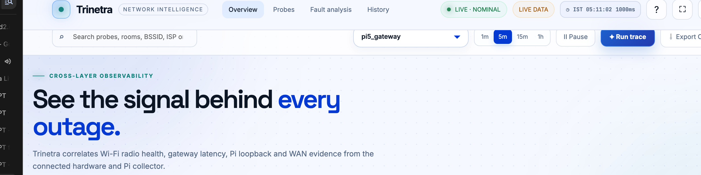

# Trinetra

### Cross-layer network intelligence for finding the real reason an Internet connection feels bad

Trinetra is a portable network-diagnostic system built with an ESP32, Raspberry Pi, mobile telemetry, MQTT, InfluxDB, and a live web dashboard. It separates a weak signal, a busy Wi‑Fi network, a slow local router, a failing mobile-data path, and a genuine outside-Internet problem.



## The problem

When somebody says “the Internet is slow”, a normal speed test gives only one answer: the final speed. It does not explain whether the problem comes from the phone signal, the Wi‑Fi link, the hotspot/router, the Raspberry Pi path, or the carrier/ISP.

Trinetra measures these layers at the same place and time, then explains the result in simple language. It avoids blaming the ISP when the local Wi‑Fi is the real problem, and avoids blaming the router when the outside network is failing.

## What Trinetra measures

| Layer | Source | Examples of evidence |
|---|---|---|
| Cellular phone | Termux + Termux:API | Carrier, network type, cell ID, RSRP, RSRQ, location |
| Wi‑Fi radio | ESP32 probe | RSSI, BSSID, channel, nearby AP count |
| Local network | ESP32 and Raspberry Pi | Gateway RTT, Pi RTT, jitter, packet loss |
| Outside Internet | Raspberry Pi WAN probe | DNS time, HTTPS success, TTFB, download throughput |
| Collector health | Raspberry Pi services | MQTT delivery, InfluxDB storage, uptime, freshness |

The dashboard never invents a value. If Android or the firmware does not report a field, it shows **Unavailable** and explains why.

## How the system works

```text
Phone + Termux:API ───────┐
ESP32 Wi‑Fi probes ────────┼── MQTT ──> Raspberry Pi ──> InfluxDB
                           │             │
                           │             ├─ WAN/DNS/HTTPS tests
                           │             ├─ live dashboard proxy :8888
                           │             └─ Trinetra web dashboard
                           │
                           └──────────────────────────────> operator
```

The Raspberry Pi is the local evidence hub. Every reading carries a probe ID, site ID, location ID, session ID, and timestamp so Jio and BSNL sessions can be compared without mixing unrelated tests.

## The conclusion shown to a normal user

The final conclusion section checks four things before giving advice:

1. **Signal** — is the phone or Wi‑Fi signal strong enough?
2. **Router/local path** — can the device reach the gateway and Pi reliably?
3. **Outside Internet** — are websites reachable and is throughput usable?
4. **Data quality** — are the readings fresh and numerous enough to trust?

Examples of conclusions:

- Weak signal plus slow Internet: move near a window or outside and repeat.
- Healthy local path plus slow Internet: investigate carrier congestion or ISP backhaul.
- Healthy Internet plus slow gateway/Pi path: check the hotspot, router, Wi‑Fi channel, or obstacles.
- Missing phone radio fields: grant Termux:API permissions or repeat the phone collection; do not infer signal quality from the Android status-bar bars.

These are operating ranges, not universal laws. A final decision should use repeated samples at the same location and a comparison session at another time or with another carrier.

## Repository layout

```text
dashboard/                  Live Trinetra UI and Pi read-only proxy
firmware/esp32_probe/       ESP32 probe firmware and safe config template
phone/                      Termux sender and phone telemetry instructions
pi_scripts/                 MQTT bridge, WAN probe, setup and survey scripts
analysis/                   Features, calibration, rules and model evaluation
data/                       Small reproducible datasets, metrics and model artifact
config/                     Docker, MQTT, Telegraf and Grafana configuration
experiments/                Controlled test procedures
tests/                      Dependency-light smoke checks
docs/                       Public dashboard screenshot and documentation assets
```

## Quick start

### Run the dashboard locally

The live UI expects InfluxDB 1.x on the configured host. For a complete local stack:

```bash
git clone <your-repository-url>
cd <repository-directory>
make check
python3 dashboard/server.py
```

Open `http://127.0.0.1:8888/`. For the field deployment, open the Pi URL instead:

```text
http://<PI_IP>:8888/
```

The dashboard is live-only. If the collector cannot be reached, it shows a clear live-error state instead of demo measurements.

### Prepare an ESP32 probe

1. Copy `firmware/esp32_probe/config.example.h` to `config.h`.
2. Set the Wi‑Fi, MQTT broker, probe ID, site ID, session ID, and location ID.
3. Open `firmware/esp32_probe/esp32_probe.ino` in Arduino IDE.
4. Compile and upload once.
5. For a new location, use the ESP32 setup portal to change Wi‑Fi and Pi details; re-uploading is not required.

`config.h` is ignored because it can contain site credentials. Never commit passwords or private tokens.

### Send phone telemetry

Install Termux and Termux:API on the phone, grant the requested permissions, and use `phone/termux_sender.sh`. The sender reads the active data SIM, cell information, location, and connection state, then publishes JSON to:

```text
piprobe/phone/telemetry
```

Use a unique session ID for each controlled Jio or BSNL run. The carrier label must come from the phone measurement; it must not be manually changed just to make a test look like Jio or BSNL.

## Raspberry Pi services

The native field deployment runs three user-space services:

```text
piprobe-mqtt   MQTT-to-InfluxDB bridge
piprobe-wan    DNS, HTTPS and throughput measurements
piprobe-dash   Trinetra dashboard and read-only InfluxDB proxy
```

Useful checks over SSH:

```bash
tmux ls
ss -ltn | grep -E ':1883|:8086|:8888'
curl -I http://127.0.0.1:8888/
curl 'http://127.0.0.1:8888/api/influx/query?db=piprobe&q=SHOW%20MEASUREMENTS'
```

The Pi dashboard proxy keeps InfluxDB off the browser and provides the API path used by the UI. It also supports a local `file://` dashboard tab for field work.

## GitHub Pages deployment

`.github/workflows/pages.yml` publishes the static dashboard UI from `dashboard/` whenever the `main` branch changes. GitHub Pages can display the interface, but real telemetry still requires a publicly reachable HTTPS proxy. A Pi address such as a private LAN address or Tailscale address is normally reachable only by devices connected to that network.

For the complete live product, use:

```text
http://<PI_IP>:8888/
```

For a public GitHub Pages deployment, configure the dashboard URL with an HTTPS `proxy` query parameter pointing to a secured Trinetra API gateway. Do not expose InfluxDB directly to the public Internet.

## Verification

The repository includes a dependency-light check:

```bash
make check
```

It verifies required files, Python compilation, deployment contracts, secret exclusions, and the model artifact. The dashboard JavaScript is also syntax-checked during development.

## Privacy and safety

- Do not commit Wi‑Fi passwords, MQTT credentials, API tokens, or `firmware/esp32_probe/config.h`.
- Treat public IP addresses, cell IDs, GPS coordinates, and router MAC addresses as survey data.
- The README screenshot is cropped to avoid exposing live network identity details.
- Keep InfluxDB and MQTT behind the Raspberry Pi or a protected VPN; expose only a read-only HTTPS dashboard proxy when public access is required.

## Project status

The prototype is operational on the Raspberry Pi with live ESP32, phone, WAN, MQTT, InfluxDB, and dashboard paths. The most important remaining field work is collecting repeated, same-location Jio and BSNL sessions with complete Termux:API radio permissions, then analysing the resulting comparison data.

## License

No open-source license has been selected yet. Add a license before accepting external contributions or redistributing the repository.
