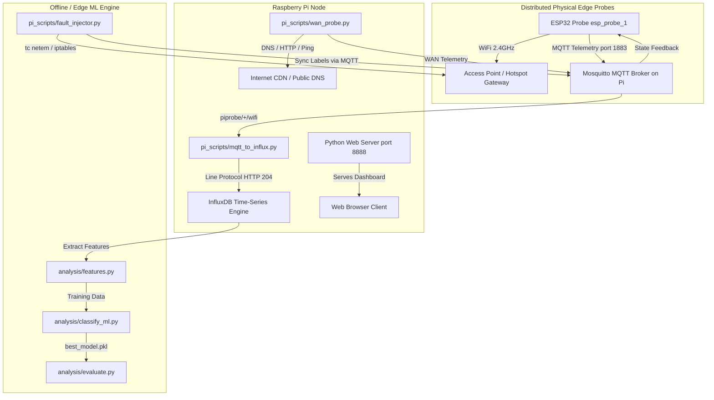

# TRINETRA (त्रिनेत्र): Distributed Multi-Layer Network Telemetry & Anomaly Diagnosis System
### (Telemetry, Routing & Intelligent Network Examination via Edge-Tier Real-Time Analytics)
## Complete Master Engineering & Operation Manual

---

### Table of Contents
1. [Project Executive Overview](#1-project-executive-overview)
2. [End-to-End System Architecture](#2-end-to-end-system-architecture)
3. [Network Topology & Hardware Setup](#3-network-topology--hardware-setup)
4. [ESP32 Firmware Deep-Dive (`esp32_probe.ino`)](#4-esp32-firmware-deep-dive-esp32_probeino)
5. [Raspberry Pi WAN Probe & Daemons](#5-raspberry-pi-wan-probe--daemons)
6. [Data Pipeline & Ingestion (`mqtt_to_influx.py`)](#6-data-pipeline--ingestion-mqtt_to_influxpy)
7. [Time-Series Database Architecture (InfluxDB)](#7-time-series-database-architecture-influxdb)
8. [Live Real-Time Dashboard](#8-live-real-time-dashboard)
9. [Machine Learning & Root-Cause Classification Pipeline](#9-machine-learning--root-cause-classification-pipeline)
10. [Automated Fault Injection Framework (`fault_injector.py`)](#10-automated-fault-injection-framework-fault_injectorpy)
11. [Chronological Engineering History & Bug Fix Log](#11-chronological-engineering-history--bug-fix-log)
12. [Master Operations & Deployment Runbook](#12-master-operations--deployment-runbook)
13. [Troubleshooting & Diagnostic Playbook](#13-troubleshooting--diagnostic-playbook)

---

## 1. Project Executive Overview

**Trinetra** is an enterprise-grade, distributed edge-intelligence system designed to monitor, disaggregate, and diagnose multi-layer network performance degradation and anomalies in real time.

### The Fundamental Problem Trinetra Solves
In standard wireless and broadband deployments, when a user experiences buffering, high latency, or packet drops, conventional network tools cannot distinguish between:
1. **Local RF degradation** (Wi-Fi attenuation, channel congestion, co-channel interference).
2. **Local Gateway/LAN bottlenecks** (AP bufferbloat, router CPU saturation, local gateway queue drops).
3. **WAN / ISP infrastructure failures** (upstream carrier congestion, DNS resolution delays, backbone packet loss).

Most user complaints are simply labeled as "bad Wi-Fi" or "internet is down." Trinetra uses dual-tier distributed hardware telemetry (ESP32 at the physical edge + Raspberry Pi at the network boundary) combined with machine learning classifiers and heuristic expert rules to isolate root causes with sub-second accuracy.

---

## 2. End-to-End System Architecture



### Data Flow Stages
1. **Physical Edge Sensing**: ESP32 micro-probes periodically measure calibrated RSSI, scan 2.4 GHz channels for neighboring AP congestion, and perform non-blocking TCP round-trip handshakes to both the Default Gateway and the Raspberry Pi.
2. **Boundary Sensing**: Raspberry Pi measures upstream WAN quality: public DNS lookup latency (Cloudflare `1.1.1.1`, Google `8.8.8.8`), HTTP TTFB to CDN edge endpoints, and ICMP ping round-trip times.
3. **MQTT Message Bus**: Telemetry payloads formatted in lightweight JSON are published to `piprobe/<PROBE_ID>/wifi` and `piprobe/wan`.
4. **Auto-Detect Ingestion Bridge**: `mqtt_to_influx.py` parses MQTT payloads, formats InfluxDB line protocol with second-precision timestamps, and commits points to InfluxDB.
5. **Real-time Glassmorphic Visualization**: Standalone, responsive HTML5/SVG dashboard polls InfluxDB every 3 seconds to render live waveforms, 4 KPI cards, RF spectrum bars, and a 4-tier cross-layer health status.
6. **Fault Injection & Evaluation**: Linux Traffic Control (`tc netem`) and `iptables` simulate real-world impairments, while ground-truth tags are broadcasted to synchronize machine learning datasets.

---

## 3. Network Topology & Hardware Setup

### Hardware Specifications
* **Edge Node**: ESP32-WROOM-32 / ESP32-WROVER (Dual-core Xtensa 240MHz, 520KB SRAM, 2.4GHz 802.11b/g/n Wi-Fi).
* **Base Station / Server**: Raspberry Pi 4 / Pi 5 (ARM Cortex-A76/A72, 4GB/8GB RAM, Gigabit Ethernet + Dual-band Wi-Fi).
* **Communication Interface**: Standard USB-UART Bridge (`CP2102` or `CH340` on `/dev/cu.usbserial-0001`).

### Active IP Address Assignments

The system operates across two supported network topologies (Mobile Hotspot vs. Local LAN):

#### Primary Topology: Mobile Hotspot Profile (`<MOBILE_HOTSPOT>` - 2.4 GHz)
| Node / Interface | Hardware MAC / Interface | IP Address | Subnet / Role |
| :--- | :--- | :--- | :--- |
| **Default Gateway (Hotspot)**| `<GATEWAY_MAC>` | `<HOTSPOT_GATEWAY_IP>` | Wi-Fi Access Point & DHCP Gateway |
| **Raspberry Pi (Wi-Fi)** | `wlan0` (`<PI_WIFI_MAC>`) | `<PI_WIFI_IP>` | MQTT Broker (Port 1883) & InfluxDB (Port 8086) |
| **ESP32 Edge Probe** | Wi-Fi Station | `<ESP32_IP>` | Live Edge Telemetry Probe (`esp_probe_1`) |
| **Raspberry Pi (Tailscale)** | `tailscale0` | `<TAILSCALE_PI_IP>` | Remote SSH and dashboard access (:8888) |
| **Host Workstation (Mac)**| Tailscale VPN | `<TAILSCALE_HOST_IP>` | IDE Development, Flashing & Dashboard Client |

#### Secondary Topology: Local WLAN Profile (`TP-Link_9953` - Home Router)
| Node / Interface | Hardware MAC / Interface | IP Address | Subnet / Role |
| :--- | :--- | :--- | :--- |
| **Default Gateway (Router)** | Router MAC | `<LAN_GATEWAY_IP>` | Local Network Gateway & DNS |
| **Raspberry Pi (Wi-Fi)** | `wlan0` (`<PI_WIFI_MAC>`) | `<LAN_PI_IP>` | MQTT Broker & InfluxDB host on LAN |
| **Raspberry Pi (Ethernet)**| `<ETHERNET_INTERFACE>` | `<ETHERNET_PI_IP>` | Secondary WAN test interface |
| **Host Workstation (Mac)**| `en0` (Wi-Fi) | `<WORKSTATION_IP>` | Local Workstation IP |

> [!IMPORTANT]
> **Broker IP Matching**: The ESP32's `MQTT_BROKER` setting must match the Raspberry Pi's active Wi-Fi IP on the same shared subnet:
> - On the mobile hotspot: Set `#define MQTT_BROKER "<PI_WIFI_IP>"`
> - On the home Wi-Fi: Set `#define MQTT_BROKER "<LAN_PI_IP>"`
>
> **2.4 GHz Band Requirement**: The ESP32 hardware radio only supports 2.4 GHz. If using a smartphone hotspot (e.g., iPhone or Android):
> - **iPhone**: Enable **Settings $\to$ Personal Hotspot $\to$ Maximize Compatibility**.
> - **Android**: Select **Settings $\to$ Hotspot $\to$ AP Band $\to$ 2.4 GHz**.

---

## 4. ESP32 Firmware Deep-Dive (`esp32_probe.ino`)

The firmware is located at [`firmware/esp32_probe/esp32_probe.ino`](file:///Users/itz-mridul/Downloads/Projects/Biot%20project/firmware/esp32_probe/esp32_probe.ino).

### Core Firmware Subsystems

#### 1. Credentials Separation & Configuration Fallback
```cpp
#if __has_include("config.h")
  #include "config.h"
#else
  #define WIFI_SSID         "<WIFI_SSID>"
  #define WIFI_PASSWORD     "<WIFI_PASSWORD>"
  #define MQTT_BROKER       "<PI_WIFI_IP>"
  #define MQTT_PORT         1883
  #define PROBE_ID          "esp_probe_1"
  #define ROOM_ID           "R1_living_room"
  #define CALIBRATION_BIAS  0.0
#endif
```
- Real credentials live in `config.h` (untracked in git).
- `config.example.h` provides a clean template.

#### 2. Native TCP Handshake RTT & RFC 3550 Jitter Engine
Rather than relying on third-party ICMP libraries that often fail on guest networks or router firewalls, `esp32_probe.ino` uses standard `WiFiClient` TCP handshake timings:
- Connects to Gateway on port 53 (DNS) with fallback to port 80 (HTTP admin).
- Connects to Pi on port 1883 (MQTT).
- Calculates round-trip connection time in milliseconds.
- Computes RFC 3550 inter-arrival jitter:
$$Jitter = \frac{1}{N - 1} \sum_{i=2}^{N} |RTT_i - RTT_{i-1}|$$
- Includes a Zero IP guard (`target == IPAddress(0,0,0,0)`) to prevent unnecessary timeout pauses.

#### 3. 64-bit `time_t` Stack-Corruption Fix
On ESP32 Arduino Core 3.x / ESP-IDF 5.x, `time_t` is 64-bit (`int64_t`). Passing a 64-bit integer to `%ld` or `%lu` misaligns the 32-bit registers on the stack. The subsequent format specifier (`%s`) then receives a `NULL` pointer (`0x0`), causing a fatal `LoadProhibited Guru Meditation` crash inside `strlen()`.
The firmware explicitly casts:
```cpp
time_t now_epoch = 0;
time(&now_epoch);
unsigned long ts_sec = (unsigned long)now_epoch;
```

#### 4. Safe Buffer Allocation & Truncation Guards
- `mqttClient.setBufferSize(768);` expands PubSubClient's transmission window.
- `payload[768]` prevents memory fragmentation while giving ample headroom for extended run IDs and JSON fields.
- Checks `snprintf` return code (`len < 0 || len >= sizeof(payload)`) before publishing.

#### 5. Periodic Spectrum & Channel Congestion Caching
To prevent Wi-Fi channel hops from disrupting RTT latency measurements, `WiFi.scanNetworks(false, true)` runs only once every 60 seconds in the background, updating `cached_ap_total` and `cached_ap_on_chan`, and freeing scan memory via `WiFi.scanDelete()`.

---

## 5. Raspberry Pi WAN Probe & Daemons

Located at [`pi_scripts/wan_probe.py`](file:///Users/itz-mridul/Downloads/Projects/Biot%20project/pi_scripts/wan_probe.py).

### WAN Metrics Gathered
* **DNS Resolution Time**: Directly queries upstream nameservers (`1.1.1.1`, `8.8.8.8`) for root domains (`google.com`, `cloudflare.com`).
* **HTTP Latency**: Measures Time-to-First-Byte (TTFB) against reliable global CDN endpoints.
* **ICMP Ping Latency**: Measures packet transit to external backbones.
* **Network Hop Count**: Discovers routing changes and upstream ISP rerouting via fast UDP traceroute.

### Systemd Integration
Template service [`pi_scripts/piprobe-wan.service`](file:///Users/itz-mridul/Downloads/Projects/Biot%20project/pi_scripts/piprobe-wan.service) runs as `piprobe-wan@<user>.service`, eliminating hardcoded user paths.

---

## 6. Data Pipeline & Ingestion (`mqtt_to_influx.py`)

Located at [`pi_scripts/mqtt_to_influx.py`](file:///Users/itz-mridul/Downloads/Projects/Biot%20project/pi_scripts/mqtt_to_influx.py).

### InfluxDB Dual-Version Compatibility
The bridge dynamically interrogates the InfluxDB `/ping` endpoint on boot:
* If `X-Influxdb-Version` starts with `1.x`:
  - Target URL: `http://localhost:8086/write?db=piprobe&precision=s`
  - Authentication: None / Basic
* If `X-Influxdb-Version` starts with `2.x`:
  - Target URL: `http://localhost:8086/write?db=piprobe&precision=s`
  - Authentication: `Authorization: Token <INFLUX_TOKEN>`

### InfluxDB Line Protocol Serialization
Incoming JSON payloads are converted to InfluxDB Line Protocol:
```text
network_telemetry,bssid=00:11:22:33:44:55,channel=6,fault_class=normal,layer=wifi,probe_id=esp_probe_1,room_id=R1_living_room,run_id=live,split=train ap_count_on_channel=3,ap_count_total=8,free_heap_bytes=210000,gw_loss_pct=0,gw_rtt_jitter_ms=1.8,gw_rtt_mean_ms=14.2,pi_loss_pct=0,pi_rtt_jitter_ms=1.2,pi_rtt_mean_ms=11.5,reconnect_count=0,rssi_calibrated_dbm=-55,rssi_raw_dbm=-55,uptime_sec=120 1729762280
```
Timestamp precision is explicitly passed as `&precision=s` to ensure epoch seconds are never misinterpreted as nanoseconds.

---

## 7. Time-Series Database Architecture (InfluxDB)

* **Engine**: InfluxDB 1.13.1 native engine on Raspberry Pi (port 8086).
* **Database**: `piprobe`
* **Measurement**: `network_telemetry`

### Tag Keys (Indexed for Fast Filtering)
* `probe_id`: Identifier for the physical probe (e.g., `esp_probe_1`).
* `layer`: Telemetry layer (`wifi`, `wan`, `lan`).
* `room_id`: Physical location (e.g., `R1_living_room`).
* `channel`: Wi-Fi channel in use (e.g., `6`, `11`).
* `bssid`: MAC address of connected AP.
* `fault_class`: Ground-truth label injected (`normal`, `interference`, etc.).
* `run_id`: Experiment run identifier.
* `split`: Machine learning dataset split (`train`, `val`, `test`).

### Field Keys (Numeric Telemetry Metrics)
| Metric | Type | Unit | Description |
| :--- | :--- | :--- | :--- |
| `rssi_raw_dbm` | Float | dBm | Raw received signal strength |
| `rssi_calibrated_dbm`| Float | dBm | Hardware-bias calibrated RSSI |
| `gw_rtt_mean_ms` | Float | ms | Round-trip latency to gateway |
| `gw_rtt_jitter_ms` | Float | ms | RFC 3550 packet jitter to gateway |
| `gw_loss_pct` | Float | % | Packet loss percentage to gateway |
| `pi_rtt_mean_ms` | Float | ms | Round-trip latency to Pi broker |
| `pi_rtt_jitter_ms` | Float | ms | Packet jitter to Pi broker |
| `pi_loss_pct` | Float | % | Packet loss percentage to Pi broker |
| `ap_count_total` | Integer | count | Total detectable neighbor APs |
| `ap_count_on_channel`| Integer | count | Detectable APs on same channel |
| `uptime_sec` | Integer | seconds| Probe system uptime |
| `free_heap_bytes` | Integer | bytes | Available ESP32 SRAM |
| `reconnect_count` | Integer | count | Total Wi-Fi disconnection events |

---

## 8. Live Real-Time Dashboard

Located at [`dashboard/index.html`](file:///Users/itz-mridul/Downloads/Projects/Biot%20project/dashboard/index.html).

### Visual & Architectural Design
1. **Light Glassmorphism Theme**: Curated Slate/Indigo palette (`#f8fafc` background, `#4f46e5` primary accent, glass blur panels).
2. **Infinite Downward Expansion Elimination**: Replaced Chart.js canvas elements (which triggered recursive height recalculation loops upon data push) with mathematically constrained inline SVG path interpolation (`preserveAspectRatio="none"` in fixed-height bounds).
3. **Canonical InfluxDB path**: The project uses InfluxDB 1.x/InfluxQL for native and Docker deployments, queried through `/query?db=piprobe`.

### Dashboard Component Anatomy
* **Header Bar**: Live pulse indicator, selected active probe switcher, system status badge.
* **4 Core KPI Cards**:
  1. *Wi-Fi RSSI*: Calibrated signal strength with dynamic health tags (Excellent, Good, Poor).
  2. *Gateway RTT*: Local LAN latency with color-coded jitter tag.
  3. *WAN / Cloud Latency*: End-to-end internet ping and status.
  4. *Packet Loss*: Combined loss percentage with zero-loss green pill.
* **SVG Dual Real-Time Waveform**: Dual-colored smoothed bezier curve plotting RSSI (primary line) and Gateway Latency (secondary cyan line) over time.
* **Neighbor AP & Congestion Table**: Dynamic breakdown of nearby SSIDs, channel numbers, and signal strengths.
* **4-Stage Cross-Layer Diagnostic Pipeline**:
  - `Physical`: Signal strength and RF attenuation.
  - `Data Link`: Channel saturation and co-channel contention.
  - `Network / LAN`: Gateway responsiveness and local packet drops.
  - `Application / WAN`: Cloud reachability and DNS resolution.
* **Control Dock**: Live fault classification chip reflecting active fault injection state.

---

## 9. Machine Learning & Root-Cause Classification Pipeline

### Module Structure
* [`analysis/features.py`](file:///Users/itz-mridul/Downloads/Projects/Biot%20project/analysis/features.py): Feature extraction engine.
* [`analysis/generate_sample_data.py`](file:///Users/itz-mridul/Downloads/Projects/Biot%20project/analysis/generate_sample_data.py): Synthetic ground-truth generator.
* [`analysis/classify_ml.py`](file:///Users/itz-mridul/Downloads/Projects/Biot%20project/analysis/classify_ml.py): Model training and cross-validation pipeline.
* [`analysis/evaluate.py`](file:///Users/itz-mridul/Downloads/Projects/Biot%20project/analysis/evaluate.py): Model test evaluation and metric reporting.
* [`analysis/classify_rules.py`](file:///Users/itz-mridul/Downloads/Projects/Biot%20project/analysis/classify_rules.py): Expert heuristic rule-based engine.
* [`analysis/calibration.py`](file:///Users/itz-mridul/Downloads/Projects/Biot%20project/analysis/calibration.py): Multi-board RF antenna bias calibration.

### Derived Features for Classification
1. `rssi_rtt_index`: Ratio of normalized RSSI to normalized RTT. High index (strong signal + high latency) is a distinct signature of RF interference or bufferbloat.
2. `rtt_ratio`: $\frac{WAN\_RTT}{Gateway\_RTT}$. Isolates whether latency spikes originate before or after the default gateway.
3. `channel_congestion_ratio`: $\frac{APs\text{ on channel}}{Total\text{ APs}}$.
4. Rolling window standard deviations ($\sigma_{RSSI}, \sigma_{RTT}$) for detecting bursty packet drops.

### Supported Fault Classes
| Fault ID | Class Name | Distinct Telemetry Signature |
| :--- | :--- | :--- |
| `F0` | `normal` | RSSI > -65 dBm, GW RTT < 20ms, Loss = 0%, WAN RTT < 40ms |
| `F1` | `wifi_weak_signal` | RSSI < -78 dBm, moderate GW RTT increase, intermittent loss |
| `F2` | `channel_congestion`| Congestion ratio > 0.6, high jitter, moderate RSSI |
| `F3` | `router_bufferbloat`| Strong RSSI, Gateway RTT surges > 150ms during load, Jitter high |
| `F4` | `gateway_failure` | 100% loss to Gateway IP, Pi link accessible, WAN unreachable |
| `F5` | `dns_outage` | Gateway & WAN ping normal, DNS lookup timeout > 2000ms |
| `F6` | `isp_congestion` | Gateway RTT normal (< 10ms), WAN RTT > 200ms, WAN loss > 5% |
| `F7` | `interference` | High RSSI with sudden packet bursts and high jitter |
| `F8` | `ap_overload` | Severe local loss (> 15%) and rate clamping on LAN |

---

## 10. Automated Fault Injection Framework (`fault_injector.py`)

Located at [`pi_scripts/fault_injector.py`](file:///Users/itz-mridul/Downloads/Projects/Biot%20project/pi_scripts/fault_injector.py).

Uses Linux `tc` (Traffic Control) with Network Emulation (`netem`) and `iptables` rules on the Raspberry Pi:

```python
# F1: DNS Drop
iptables -A OUTPUT -p udp --dport 53 -j DROP

# F2: WAN Latency Spike
tc qdisc add dev eth0 root netem delay 250ms 30ms distribution normal

# F3: WAN Packet Loss
tc qdisc add dev eth0 root netem loss 15%

# F4: Bufferbloat Simulation
tc qdisc add dev eth0 root netem delay 100ms 40ms loss 5%

# F5: Wi-Fi Interference Simulation
tc qdisc add dev wlan0 root netem delay 45ms 25ms loss 8% corrupt 2%

# F6: AP Overload Simulation
tc qdisc add dev wlan0 root netem delay 80ms 30ms loss 12% rate 256kbit
```

All commands verify exit return codes; failures abort the experiment trial to prevent mislabeling training data. Ground-truth state changes are broadcast via MQTT to `piprobe/control/state`.

---

## 11. Chronological Engineering History & Bug Fix Log

Below is the complete record of issues diagnosed and resolved across all project iterations:

### 1. InfluxDB Version Architecture Mismatch
* **Resolution**: Docker and native deployments now use InfluxDB 1.x database `piprobe`, matching `mqtt_to_influx.py`, `dashboard/server.py`, and `dashboard/index.html`. The bridge still auto-detects a compatible Influx endpoint for existing native installations.

### 2. Missing ML Sample Data Module
* **Symptom**: `analysis/classify_ml.py --sample` threw `ModuleNotFoundError: No module named 'generate_sample_data'`.
* **Fix**: Implemented [`analysis/generate_sample_data.py`](file:///Users/itz-mridul/Downloads/Projects/Biot%20project/analysis/generate_sample_data.py) with `generate_features_csv()`, producing balanced, statistically realistic synthetic multi-class datasets.

### 3. Evaluator Array Indexing Bug
* **Symptom**: `analysis/evaluate.py:56` crashed with `IndexError` when multiple non-WAN samples were passed (`y_pred[non_wan_idx] == wan_labels`).
* **Fix**: Refactored to vectorized membership check:
  `np.isin(np.array(y_pred)[non_wan_idx], wan_labels).mean()`.
  Wired `--features` to load `best_model.pkl` and evaluate arbitrary datasets directly.

### 4. Fault Injector No-Op for F5/F6
* **Symptom**: `fault_injector.py` tagged faults F5 and F6 without applying kernel-level network impairments.
* **Fix**: Implemented `inject_f5_interference()` and `inject_f6_ap_overload()` using `tc netem` with packet corruption, jitter, and rate limiting. Added exit code validation to abort trials on command failures.

### 5. Calibration Bias Sign Inversion
* **Symptom**: `analysis/calibration.py:69` had an inverted sign formula for probe RSSI bias, amplifying calibration errors instead of nullifying them.
* **Fix**: Corrected to `stats["firmware_calibration_bias_dbm"] = round(ref_mean - stats["mean"], 3)`.

### 6. Rule-Based Classification Voting Gap
* **Symptom**: When Rule 7 triggered, collected probe votes were discarded, falling back to "inconclusive".
* **Fix**: Added Rule 8 in `analysis/classify_rules.py` to aggregate and return majority `probe_fault` consensus votes with reasoning.

### 7. ESP32 Fatal Guru Meditation Panic
* **Symptom**: Probe rebooted continuously after connecting to Wi-Fi with `LoadProhibited Guru Meditation Error` in `strlen()`.
* **Fix**: Identified 64-bit `time_t` stack alignment bug on ESP32 Core 3.x. Cast `now_epoch` to `(unsigned long)` before calling `snprintf`.

### 8. Dashboard Recursive Downward Resize
* **Symptom**: The web dashboard at `http://<PI_HOST>:8888` continually expanded vertically, breaking the layout.
* **Fix**: Diagnosed Chart.js canvas elements triggering layout resize events inside flexible containers. Replaced with pure inline SVG path curves bounded in fixed CSS grid containers.

### 9. Hardcoded Secrets & Missing Example Configurations
* **Symptom**: Wi-Fi credentials were hardcoded in `esp32_probe.ino`, and Docker had hardcoded admin tokens.
* **Fix**: Externalized credentials into `firmware/esp32_probe/config.h` (with `config.example.h`) and created `config/.env.example`.

### 10. Gateway 0.0.0.0 Hang & Buffer Sizing
* **Symptom**: Disconnections caused 1.5s measurement hangs, and expanding run IDs risked payload truncation.
* **Fix**: Added zero-IP check in `measureTargetRtt()`, increased PubSubClient buffer to 768 bytes, and bounded MQTT reconnection retries to 3 attempts.

---

## 12. Master Operations & Deployment Runbook

### Starting the Base Station Services on Raspberry Pi
Connect to the Pi via SSH and run:

```bash
# 1. Start MQTT-to-InfluxDB ingestion bridge in tmux
tmux new-session -d -s piprobe-mqtt 'python3 /home/mridul/piprobe/pi_scripts/mqtt_to_influx.py'

# 2. Start Dashboard HTTP server in tmux
tmux new-session -d -s piprobe-dash 'cd /home/mridul/piprobe/dashboard && python3 -m http.server 8888'

# 3. Verify both sessions are active
tmux ls
```

### Inspecting Live Bridge Logs
```bash
tmux capture-pane -pt piprobe-mqtt
```
*Expected log output:*
```text
[INFO] [InfluxDB] Detected InfluxDB v1 (1.13.1). Target DB: 'piprobe'
[INFO] [MQTT] Connected. Subscribing to piprobe/+/wifi
[INFO] [Ingested] piprobe/esp_probe_1/wifi: RSSI=-52 dBm, GW RTT=13.5ms
```

### Verifying InfluxDB Data Ingestion
```bash
curl -s 'http://localhost:8086/query?db=piprobe&q=SELECT+*+FROM+network_telemetry+ORDER+BY+time+DESC+LIMIT+1'
```

### Accessing the Web Dashboard
Open any browser on the local network or Tailscale and navigate to:
```text
http://<PI_HOST>:8888/
```

### Flashing the ESP32 Probe
1. Open the project folder in **Arduino IDE**.
2. Open [`firmware/esp32_probe/esp32_probe.ino`](file:///Users/itz-mridul/Downloads/Projects/Biot%20project/firmware/esp32_probe/esp32_probe.ino).
3. Ensure [`firmware/esp32_probe/config.h`](file:///Users/itz-mridul/Downloads/Projects/Biot%20project/firmware/esp32_probe/config.h) has your active network credentials:
   ```cpp
   #define WIFI_SSID         "<WIFI_SSID>"
   #define WIFI_PASSWORD     "<WIFI_PASSWORD>"
   #define MQTT_BROKER       "<PI_WIFI_IP>"
   #define MQTT_PORT         1883
   ```
4. Select **Board: ESP32 Dev Module** and Port: `/dev/cu.usbserial-0001`.
5. Click **Upload ($\rightarrow$)**.
6. Open **Serial Monitor** at **115200 baud** to confirm association and telemetry transmission.

### Retraining & Evaluating the ML Model
```bash
# Generate fresh dataset and train models
python3 analysis/classify_ml.py --sample

# Run model evaluation against feature set
python3 analysis/evaluate.py --features data/features.csv
```

---

## 13. Troubleshooting & Diagnostic Playbook

### Issue: ESP32 shows `[Wi-Fi] Association failed`
* **Root Cause 1**: Hotspot is running in 5 GHz-only mode.
  - *Fix*: Enable "Maximize Compatibility" (iOS) or select 2.4 GHz AP Band (Android).
* **Root Cause 2**: SSID or password typo.
  - *Fix*: Verify credentials in `config.h` and re-flash.

### Issue: ESP32 connects to Wi-Fi but shows `[MQTT] failed, rc=-2`
* `rc = -2` means network connection failed (broker unreachable).
* **Check Broker Address**: Ensure `MQTT_BROKER` in `config.h` is set to the Pi's current Wi-Fi IP, **not** `localhost`.
* **Check Broker Process**: Verify Mosquitto is active on the Pi:
  ```bash
  ssh <PI_USER>@<PI_HOST> "pgrep mosquitto && ss -tulpn | grep 1883"
  ```

### Issue: Dashboard loads, but cards show `--` or no new data appears
* **Check Bridge**: Ensure `mqtt_to_influx.py` is running:
  ```bash
  ssh <PI_USER>@<PI_HOST> "tmux capture-pane -pt piprobe-mqtt"
  ```
  If not running, launch it using `tmux new-session -d -s piprobe-mqtt 'python3 /home/mridul/piprobe/pi_scripts/mqtt_to_influx.py'`.
* **Check InfluxDB**: Ensure port 8086 is listening:
  ```bash
  ssh <PI_USER>@<PI_HOST> "curl -I http://localhost:8086/ping"
  ```

### Issue: ESP32 prints `Payload buffer truncated!`
* **Root Cause**: The JSON payload exceeded the allocated buffer size.
* **Fix**: Ensure both `mqttClient.setBufferSize(768)` and `char payload[768]` are defined in `esp32_probe.ino`.

---

*Trinetra Complete System Reference | Generated for Project Repository at `/Users/itz-mridul/Downloads/Projects/Biot project`*
